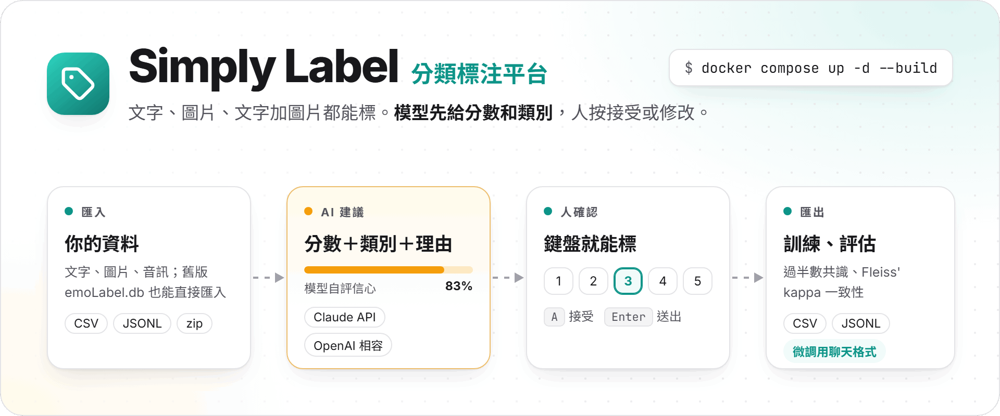
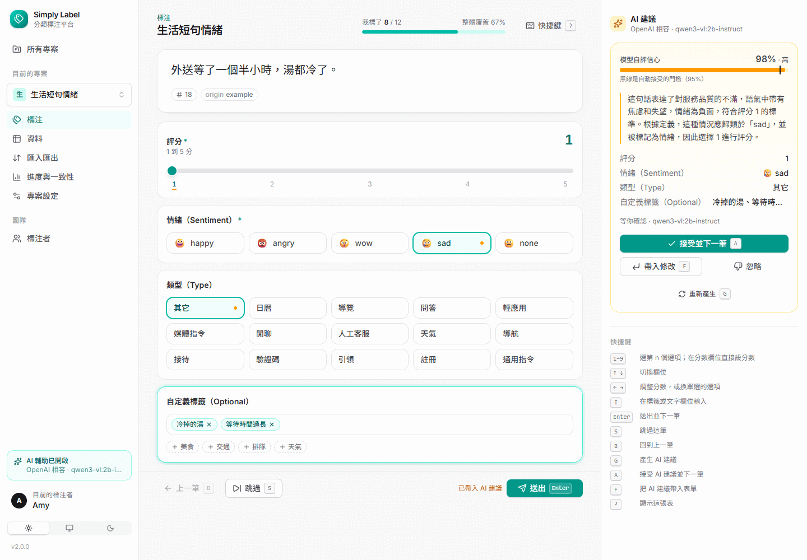
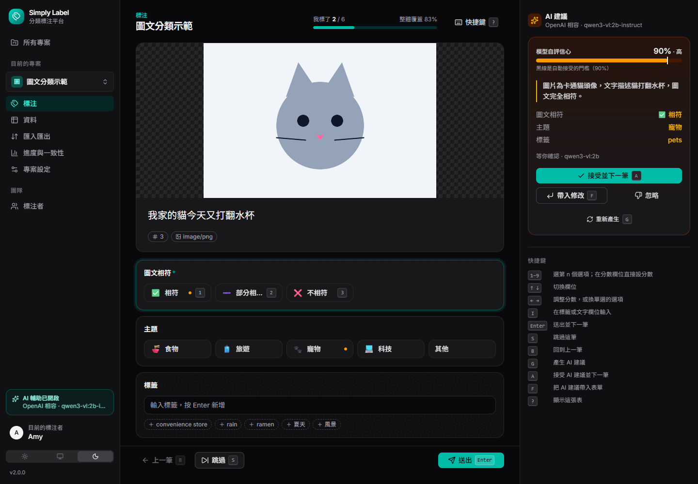
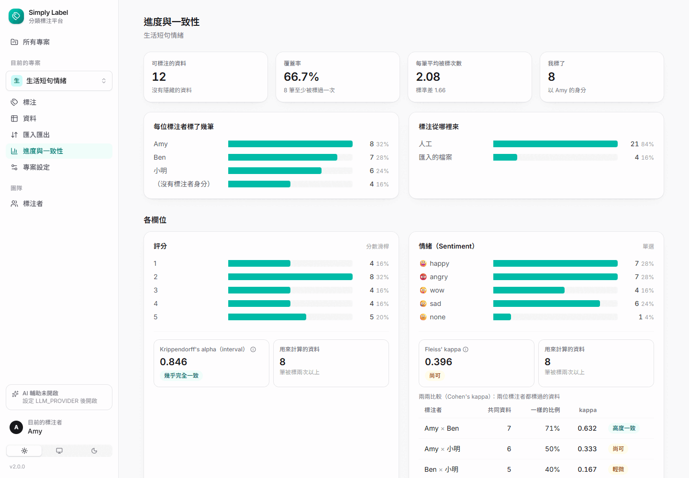
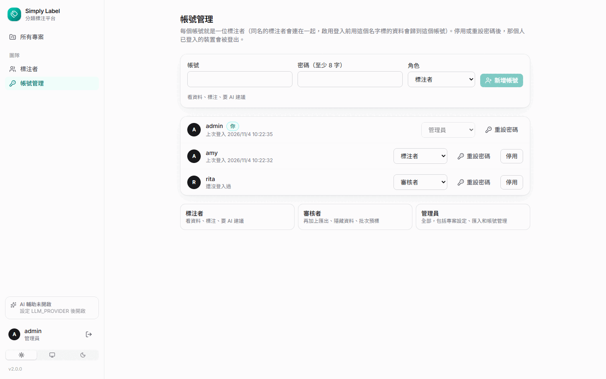
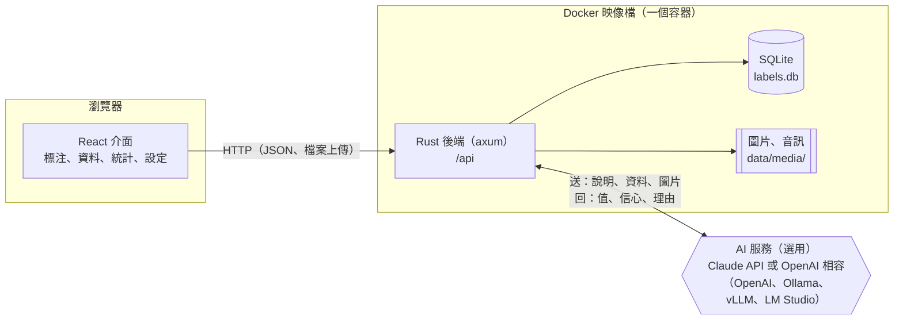
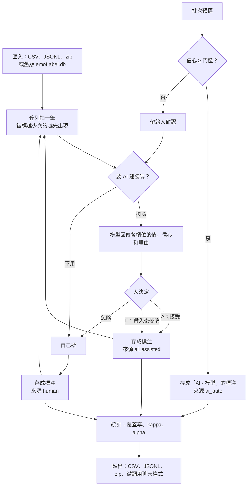

<p align="center">
  <picture>
    <source media="(prefers-color-scheme: dark)" srcset="https://raw.githubusercontent.com/NatLee/simply-nlp-classification-labeling-platform/main/docs/images/hero-dark.png">
    
  </picture>
</p>

<p align="center">
  <a href="https://github.com/NatLee/simply-nlp-classification-labeling-platform/actions/workflows/ci.yml"></a>
  
  
  
  <a href="LICENSE"></a>
</p>

自架的分類標注平台：替文字、圖片或「文字加圖片」標上分數和類別，做成訓練或評估模型用的資料集。標注結構每個專案自己定（分數滑桿、單選、多選、自由標籤、文字說明），可以多人一起標並算一致性（Cohen's／Fleiss' kappa、Krippendorff's alpha）。接上 Claude API 或任何 OpenAI 相容的服務（OpenAI、Ollama、vLLM、LM Studio）之後，模型會先給建議和理由，人按一個鍵接受或修改。

後端是 Rust（axum＋SQLite），前端是 React＋Tailwind CSS，整套打包成一個 Docker 映像檔。2019 年的 Flask 版（emoLabel）功能全部保留，舊的 `emoLabel.db` 和 CSV 範本都能直接匯入。

*A self-hosted labeling platform for scores and categories on text, images or both, with multi-annotator agreement stats and optional AI pre-labelling through the Claude API or any OpenAI-compatible endpoint. Rust + React, one Docker image. The UI is in Traditional Chinese.*

<p align="center">
  
</p>

<details>
<summary>更多截圖：深色模式的圖文標注、進度與一致性、帳號管理</summary>

<p align="center">
  
  
  
</p>

截圖是用 headless Edge 拍的真實畫面，資料是 `examples/` 裡的範例，AI 建議來自本機 Ollama 上的 `qwen3-vl:2b-instruct` 和 `qwen3-vl:2b`。
</details>

## 功能

- **標注結構可以設定**：連續分數滑桿（範圍和間隔自訂）、單選、多選、自由標籤、文字說明，每個欄位可以設必填和預設值。已經有標注之後也能改結構，只要不會讓舊的標注失效（例如拿掉用過的選項會被擋下）。內建三個範本，其中「情緒評分（舊版相容）」和舊版一模一樣。
- **多模態資料**：每筆可以是文字、圖片、音訊，或文字加圖片／音訊。圖片可以點開放大，音訊直接播放。
- **鍵盤就能標**：數字鍵選選項或設分數，方向鍵換欄位，Enter 送出並自動換下一筆。下一筆照舊版的規則挑：被標越少次的越容易出現。
- **AI 輔助標注**（選用）：模型看過標注說明和資料（含圖片）後，給出每個欄位的值、自評信心和一句理由。可以接受、帶入後修改或忽略；批次預標時，信心超過門檻的直接存成「AI · 模型名稱」標注者的標注，其他的留給人確認。
- **多位標注者和一致性**：每個人的標注分開記錄（要的話可以打開內建登入，帳號分成標注者、審核者、管理員）。統計頁有舊版儀表板的覆蓋率、平均、標準差，加上各欄位的分布、Fleiss' kappa、兩兩的 Cohen's kappa（也能看 AI 和人一不一致），分數欄位用 Krippendorff's alpha。
- **匯入**：CSV（兩種舊範本都支援）、JSONL、zip（圖片或音訊，可以附清單檔），可以連同已經標好的值一起匯入。有任何一列不對，整批都不會匯入，並列出每一列的問題。
- **匯出**：CSV（每筆標注一列，或每筆資料一列的過半數共識）、JSONL、zip（連同媒體檔，可以再匯入）、微調和評估用的聊天格式 JSONL。
- **舊版資料**：舊的 `emoLabel.db` 從網頁或指令都能匯入成新專案，分數、情緒、類型、自訂標籤和隱藏旗標都對得上。
- 淺色和深色模式，手機也能用。

## 快速開始

需要 Docker 和 Docker Compose。

```bash
git clone https://github.com/NatLee/simply-nlp-classification-labeling-platform.git
cd simply-nlp-classification-labeling-platform
docker compose up -d --build
```

打開 <http://localhost:5000>（和舊版同一個 port；要換的話設 `LABEL_PORT`，例如 `LABEL_PORT=8080 docker compose up -d`）：

1. 第一次進入會請你選一位標注者，輸入名字新增就好。
2. 按「新增專案」，選一個範本。
3. 到「匯入匯出」上傳資料。不知道格式的話，那一頁可以下載這個專案的 CSV 範本和幾個範例檔。
4. 到「標注」開始標。按 `?` 可以看所有快捷鍵。

資料存在 Docker volume `labeling-data`（SQLite 資料庫和上傳的圖片、音訊），備份這個 volume 就好。

## 從舊版（Flask 版）升級

舊的 `emoLabel.db` 有兩種匯入方式，都會建立一個新專案，舊檔只會被讀取、不會被改動：

- **網頁**：在「所有專案」按「匯入舊版 emoLabel.db」。
- **指令**：

  ```bash
  docker compose cp emoLabel.db labeling:/app/data/emoLabel.db
  docker compose exec labeling simply-nlp-labeling import-legacy /app/data/emoLabel.db --name 舊資料 --utc-offset +08:00
  ```

  ```
  已匯入成專案 #2「舊資料」：4 筆文字（其中 1 筆隱藏）、4 筆標注，1 筆找不到對應文字的標注已略過
  ```

舊版的資料怎麼對應過來：

| 舊版 | 新版 |
|---|---|
| `emotion.text` | 一筆資料的文字。純數字的文字在舊資料庫裡是整數，會轉回字串 |
| `emotion.flag = 0` | 隱藏的資料：留著，但不會出現在標注佇列 |
| `label.score`、`tag`、`type`、`tag_opt` | 同名的四個欄位。`tag_opt` 原本是 Python 的清單字串（`['政治']`），會轉成標籤陣列 |
| 一筆文字被標很多次 | 每次都是一筆「沒有標注者身分」的標注，一致性統計（Fleiss' kappa）照樣能算 |
| `date`、`updateDate`（沒有時區） | 用你指定的時區換算（網頁匯入時用瀏覽器的時區）；原始字串也存在資料的 `meta` 裡 |

舊版的兩種 CSV 範本也照樣能用：只有 `Text` 一欄的檔案一行就是一筆（文字裡的逗號會保留，和舊版一樣）；`Level,Classes,Custom classes,Text` 的檔案會連同標注一起匯入（舊版的這個功能只寫到一半，從來沒有開放過）。

## 匯入

上傳到「匯入匯出」頁，或用 API：

```bash
# 建立一個舊版相容的專案，匯入含標注的舊範本，再匯出共識
curl -s -H 'Content-Type: application/json' -d '{"name":"example","templateId":"legacy-emotion"}' http://localhost:5000/api/projects
curl -s -F file=@examples/labelDataExample.csv http://localhost:5000/api/projects/1/import
curl -s "http://localhost:5000/api/projects/1/export?format=csv&mode=items"
```

```
{"format":"csv","rows":4,"created":4,"duplicates":0,"annotations":4,"media":0}
item_id,text,media,n_annotations,score,tag,type,tag_opt
1,今天的晚餐超好吃，下次還要再來！,,1,5.0,happy,,"[""美食""]"
…
```

欄位（CSV 的欄名或 JSONL 的鍵）：

| 欄位 | 意思 |
|---|---|
| `text` | 文字（舊範本的 `Text` 也可以） |
| `image`、`audio`、`media`、`file_name` | 媒體檔：zip 裡的相對路徑，或 `data:image/png;base64,…`。不收網址 |
| 和標注欄位 id 一樣的欄位 | 這一列已經標好的值。多選和標籤寫成 JSON 陣列，例如 `["美食","交通"]` |
| `annotator` | 這一列標注的標注者名字；沒有就是不具名的標注 |
| `hidden` | `true` 時不出現在標注佇列 |
| 其他欄位 | 存進這筆資料的 `meta`，匯出時原樣帶出 |

- **JSONL**：一行一個物件，鍵同上；也可以用 `"annotations": [{"annotator": "Amy", "values": {...}}]` 一次放多筆標注。整個檔案是 JSON 陣列也可以。
- **zip**：放圖片或音訊（png、jpg、gif、webp、bmp、mp3、wav、ogg、m4a、flac、webm）。有 `items.jsonl`、`metadata.jsonl` 或 `items.csv` 時當成清單，路徑相對於清單檔；沒有清單時一個媒體檔一筆，同名的 `.txt`（例如 `cat.jpg` 配 `cat.txt`）當作文字。
- 同一個專案裡，文字和媒體都一樣的資料只會留一筆；同一次匯入裡重複的列（例如每位標注者一列）會合併到同一筆。
- 檔案要是 UTF-8。用 Excel 的話，另存成「CSV UTF-8」。

範例檔在 [`examples/`](examples/)，句子是為這個 repo 寫的，圖片是用 [`make-image-sample.sh`](examples/make-image-sample.sh) 畫的，可以自由使用。

## 匯出

| 格式 | 內容 | 適合 |
|---|---|---|
| CSV（每筆標注一列） | 資料、標注者、來源、時間、每個欄位的值。開頭有 BOM，Excel 開中文不會亂碼 | 人工檢查、交給別的工具 |
| CSV（每筆資料一列） | 每筆的過半數共識和標注數 | 直接訓練分類器 |
| JSONL | 每筆一行：內容、媒體資訊、`meta`、所有標注、共識。可以再匯入 | 程式處理、備份 |
| zip | `items.jsonl`＋`media/` 裡的圖片和音訊。可以再匯入 | 搬到另一台機器 |
| 聊天格式 JSONL | `messages`：system 是標注說明和欄位、user 是資料（圖片用 data URL）、assistant 是共識標注的 JSON | 微調（OpenAI、TRL、LLaMA-Factory 都讀這個格式）、評估模型 |

共識的規則是過半數：分數取平均後對齊到最近的一格；單選要超過一半的人選同一個，否則不給；多選和標籤取超過一半的人選的項目；文字說明取最新的一筆。做評估資料時可以勾「共識不算高信心自動接受的 AI 標注」，避免拿模型自己的答案評模型。

聊天格式用的提示和 AI 輔助標注是同一套，所以拿它微調出來的模型，接回這個平台當 OpenAI 相容服務時，看到的提示和訓練時一樣。

## AI 輔助標注

沒有設定時這個功能是關的，其他功能照常。要打開的話，在 `docker-compose.yml` 旁邊建立 `.env`，二選一：

```dotenv
# Claude API
LLM_PROVIDER=anthropic
ANTHROPIC_API_KEY=sk-ant-...
# ANTHROPIC_MODEL=claude-opus-5-5   # 預設值
```

```dotenv
# OpenAI 相容服務：OpenAI、Ollama、vLLM、LM Studio…
LLM_PROVIDER=openai
OPENAI_BASE_URL=http://host.docker.internal:11434/v1   # 例如本機的 Ollama
OPENAI_MODEL=qwen3-vl:2b-instruct
# OPENAI_API_KEY=...                                   # OpenAI 等需要 key 的服務才填
```

改完執行 `docker compose up -d` 重新啟動，左下角會顯示「AI 輔助已開啟」和模型名稱。API key 只在伺服器的環境變數裡，不會寫進資料庫，也不會傳到瀏覽器。

用 Ollama 在自己的電腦跑模型，資料就不會離開這台機器：

```bash
docker run -d --name ollama -p 11434:11434 -v ollama:/root/.ollama ollama/ollama
docker exec ollama ollama pull qwen3-vl:2b-instruct
```

這條路實際用 Docker 的 Ollama 0.40.5 跑過：`qwen3-vl:2b-instruct`（1.9 GB，看得懂圖）每筆圖片約 10 秒（含第一次載入）、文字 1–2 秒，建議和理由都正常存回平台，按 A 接受後標注的來源記成「看過 AI 建議後送出」。兩件要注意的事：

- **推理（thinking）版本的模型會把上下文用完。** `qwen3-vl:2b` 的思考也佔上下文，Ollama 預設只有 4096 個 token，圖片那筆生成到一半被截斷。換成不思考的 `-instruct` 版，或啟動 Ollama 時加 `-e OLLAMA_CONTEXT_LENGTH=8192`，兩種都試過可以解決。
- **小模型的自評信心不準。** 2B 的模型幾乎每筆都說自己有 90–100% 的把握，類型也常選錯（「明天要搬家」選了「通用指令」）。自動接受的門檻請搭配人工抽查使用。

Claude API 這條路的請求格式、回應解析、重試和錯誤處理都用本機的假伺服器測過（`src/api/tests/api.rs`），但這台開發機沒有 Claude 的 API key，**沒有對真的 Claude API 跑過**。


### 送什麼給模型、拿回什麼

- **送出**：專案設定裡的標注說明、每個欄位的名稱、說明、選項和範圍，以及這筆資料的文字和圖片。圖片的長邊超過 1568 px 會先縮小，不支援的格式（例如 BMP）轉成 PNG。音訊不會送出（Claude 不收音訊），只送文字。
- **拿回**：每個欄位的值、模型自評的信心（0 到 1）、一兩句繁體中文的理由。平台要求模型照 JSON Schema 回答（Claude 用 `output_config.format`，OpenAI 相容服務用 `response_format` 的 `json_schema`）。不支援結構化輸出的小模型也會照提示回 JSON，前後多寫的文字會被略過。
- **再檢查一次**：分數超出範圍就夾回範圍、對齊到格子，不認得的選項丟掉，沒辦法用的欄位留空，不會存進不合法的值。
- **信心是模型自己估的，不一定準**。自動接受的門檻預設關閉，要在「專案設定」打開；打開之前，建議先在統計頁看「AI · 模型」和人的 Cohen's kappa。
- 請求遇到 429、5xx（含 Claude 的 529 overloaded）或連線錯誤時，會重試兩次；還是失敗就在畫面上顯示原因（例如「API key 無效」「找不到模型」）。

### Claude API 的細節

Rust 沒有官方的 Anthropic SDK，所以直接呼叫 Messages API（`POST /v1/messages`，`anthropic-version: 2026-10-21`）：

- 預設模型 `claude-opus-5-5`，思考深度 `effort: low`（分類是短任務，`ANTHROPIC_EFFORT` 可以改）。Opus 5.5 的思考一定開著，不另外設定。
- 預設開啟伺服器端的備用模型（`fallbacks: "default"`，beta 標頭 `server-side-fallback-2026-07-01`）：模型拒答時，API 會自動改用 Anthropic 建議的備用模型重跑一次，建議面板上會顯示實際回答的模型。不想要的話設 `ANTHROPIC_FALLBACKS=off`。
- 不送 `temperature`、`top_p`、`top_k`（這個 API 版本不接受）。
- 圖片用 base64 的 `image` 區塊，放在文字前面。


## 鍵盤快捷鍵

| 鍵 | 動作 |
|---|---|
| `1`–`9` | 選第 n 個選項（多選是切換）；在分數欄位直接設成那個分數 |
| `↑` `↓` | 換欄位 |
| `←` `→` | 分數加減一格；單選換上一個或下一個選項 |
| `I` | 在標籤或文字欄位開始輸入（`Esc` 離開） |
| `Enter` | 送出並換下一筆（在文字欄位裡用 `Ctrl`＋`Enter`） |
| `S` | 跳過這筆 |
| `B` | 回到上一筆 |
| `G` | 產生 AI 建議 |
| `A` | 接受 AI 建議並換下一筆 |
| `F` | 把 AI 建議帶入表單再修改 |
| `?` | 顯示快捷鍵 |

## 一致性怎麼算

- **Fleiss' kappa**（單選欄位）：所有被標兩次以上的資料一起算，扣掉「碰巧選到一樣」的機率。不用知道是誰標的，所以舊版的匿名標注也能算。每筆的標注人數可以不同。
- **Cohen's kappa**（單選欄位，兩兩比較）：兩位具名標注者都標過的資料。AI 標注者也算一位，可以看模型和人的一致程度。
- **Krippendorff's alpha（interval）**（分數欄位）：分數差多少比較重要時用，允許缺值、人數不固定。

1 是完全一致，0 和碰巧差不多，負的比碰巧還差。統計頁的「高度一致」等說法依 Landis & Koch（1977）的分級，只是慣例。計算結果和 statsmodels、scikit-learn、krippendorff 套件對過教科書上的例子。

## 設定

都用環境變數設定，全部有預設值。用 Compose 時寫在同一個資料夾的 `.env`（已經被 `.gitignore` 和 `.dockerignore` 排除）。

| 變數 | 預設 | 說明 |
|---|---|---|
| `LABEL_BIND` | `0.0.0.0:5000` | 監聽位址 |
| `LABEL_DATA_DIR` | `data`（Docker 內是 `/app/data`） | 資料庫和媒體檔的資料夾 |
| `LABEL_DATABASE_PATH` | `$LABEL_DATA_DIR/labels.db` | SQLite 檔案 |
| `LABEL_STATIC_DIR` | `src/web/dist`（Docker 內是 `/app/web`） | 前端檔案 |
| `LABEL_MAX_UPLOAD_MB` | `200` | 上傳檔案的大小上限；zip 解開後最多是這個的 5 倍 |
| `LABEL_PORT` | `5000` | 只有 Compose 用：對外的 port |
| `LLM_PROVIDER` | （空） | `anthropic` 或 `openai`；空的時候 AI 功能關閉 |
| `ANTHROPIC_API_KEY` | （空） | Claude API 的 key |
| `ANTHROPIC_MODEL` | `claude-opus-5-5` | Claude 模型 |
| `ANTHROPIC_EFFORT` | `low` | 思考深度（`low`、`medium`、`high`…）；`off` 表示不送（給不支援的舊模型） |
| `ANTHROPIC_FALLBACKS` | `default` | 模型拒答時讓 API 改用建議的備用模型重跑；`off` 關閉 |
| `ANTHROPIC_BASE_URL` | `https://api.anthropic.com` | 走代理時才需要改 |
| `OPENAI_BASE_URL` | `https://api.openai.com/v1` | OpenAI 相容服務的網址，例如 Ollama 是 `http://主機:11434/v1` |
| `OPENAI_API_KEY` | （空） | 需要的話才填（Ollama 不用） |
| `OPENAI_MODEL` | （空，必填） | 模型名稱 |
| `LLM_TIMEOUT_SECS` | `120` | 每個請求的逾時 |
| `LLM_CONCURRENCY` | `2` | 批次預標同時送幾個請求 |
| `ADMIN_PASSWORD` | （空） | 設了才會啟用內建登入，見下方「登入」；至少 8 個字元 |
| `ADMIN_USERNAME` | `admin` | 管理員帳號 |
| `PUBLIC_URL` | （空） | 外部看到的網址，例如 `https://label.example.com`；檢查請求來源用，是 https 時 session cookie 會加 Secure |
| `COOKIE_SECURE` | 看 `PUBLIC_URL` | `true`／`false`：強制設定 session cookie 的 Secure |
| `RUST_LOG` | `info,sqlx=warn` | 伺服器 log 等級 |

## 登入

預設不用登入（和舊版一樣），選誰就以誰的身分標注，適合放在自己的電腦或信任的內網。要讓別人從網路連進來，請打開內建登入，並放在 HTTPS 後面（例如 Caddy、nginx 或 Cloudflare Tunnel），不然任何人都能看資料、用你的 AI 額度。

在 `.env` 加上管理員密碼，重新啟動就會啟用：

```dotenv
ADMIN_PASSWORD=請換成一個長的密碼
# ADMIN_USERNAME=admin                     # 預設值
PUBLIC_URL=https://label.example.com       # 經過 HTTPS 時設定，cookie 會加上 Secure
```

- 每次啟動都會確認管理員帳號：沒有就建立，已經有了就把密碼改成 `ADMIN_PASSWORD`。忘記密碼時，改這個值再重新啟動就好。沒有任何預設密碼。
- 管理員到「帳號管理」新增帳號、改角色、重設密碼、停用帳號。停用或重設密碼後，那個人已經登入的裝置會被登出。
- 角色：**標注者**可以看資料、標注、要 AI 建議；**審核者**再加上匯出、隱藏資料和批次預標；**管理員**全部都可以，包括專案設定、匯入和帳號管理。
- 每個帳號就是一位標注者，登入後只能用自己的身分標注。建立帳號時會連到同名的標注者，所以啟用登入前用這個名字標的資料，會歸到這個帳號。
- 啟用之後，除了 `/api/health`、`/api/meta` 和登入本身，所有 API 都要登入，包括 AI 建議、匯入匯出、圖片和音訊檔。用命令列呼叫時要先登入、帶上 cookie：

  ```bash
  curl -c jar -H 'Content-Type: application/json' -d '{"username":"admin","password":"…"}' http://localhost:5000/api/auth/login
  curl -b jar http://localhost:5000/api/projects
  ```

- 密碼用 argon2 雜湊保存；session 放在 HttpOnly、SameSite=Lax 的 cookie，30 天後過期，資料庫只存 token 的雜湊。寫入的請求如果來自別的網站（`Origin` 和這個網站不同）會被拒絕。同一個帳號 15 分鐘內登入失敗 5 次，會暫時擋下。

## 架構



## 標注流程



## 開發

```
src/
  api/   Rust 後端（axum + sqlx + SQLite）
  web/   React 前端（Vite + TypeScript + Tailwind CSS）
docs/
  api.md        HTTP API 規格
  pitfalls.md   踩坑紀錄
  images/       封面和截圖（src/hero.html 是封面的原始檔）
examples/       範例檔（匯入頁可以下載，也會編進執行檔）
```

後端（需要 stable 版 Rust）：

```bash
cd src/api
cargo run          # http://localhost:5000，資料存在 src/api/data/
cargo test         # 單元測試＋整合測試（AI 服務用本機假伺服器模擬；登入的測試在 tests/auth.rs）
```

從 repo 根目錄執行 `cargo run --manifest-path src/api/Cargo.toml` 時，會直接提供 `src/web/dist` 裡編好的前端。

前端（需要 Node 22 以上和 pnpm 10）：

```bash
cd src/web
pnpm install
pnpm dev           # http://localhost:5173，/api 會轉給 5000 的後端
pnpm test          # vitest：主要流程和表單邏輯
pnpm build         # 輸出到 src/web/dist
```

## 授權和範例資料

- `examples/` 的句子是為這個 repo 寫的，圖片是用 ImageMagick 畫的示意圖，可以自由使用。
- 舊版的測試資料來自 [sweslo17/chinese_sentiment](https://github.com/sweslo17/chinese_sentiment)。那個 repo 沒有授權條款，所以這裡不附它的資料，舊介面上引用的三句也拿掉了。
- 這個專案用 [MIT 授權](LICENSE)。

## 版本紀錄

- **2.0.0（2026-11）**：用 Rust＋React 重寫，打包成一個 Docker 映像檔。標注結構可以設定、支援圖片和音訊、多位標注者和一致性統計、AI 輔助標注（Claude API 或 OpenAI 相容）、更多匯入匯出格式、選用的內建登入。舊版的功能都保留，舊的 `emoLabel.db` 可以匯入。改用 MIT 授權。
- **1.x（2019–2023）**：Flask 版（`main.py`、`EmoLabel.py`），程式碼保留在 git 歷史中。

## 貢獻者

<!-- ALL-CONTRIBUTORS-LIST:START - Do not remove or modify this section -->
<!-- prettier-ignore-start -->
<!-- markdownlint-disable -->
<table>
  <tbody>
    <tr>
      <td align="center"><a href="https://github.com/NatLee"><br /><sub><b>Nat Lee</b></sub></a></td>
      <td align="center"><a href="https://github.com/h-alice"><br /><sub><b>H-Alice</b></sub></a></td>
    </tr>
  </tbody>
</table>

<!-- markdownlint-restore -->
<!-- prettier-ignore-end -->

<!-- ALL-CONTRIBUTORS-LIST:END -->
